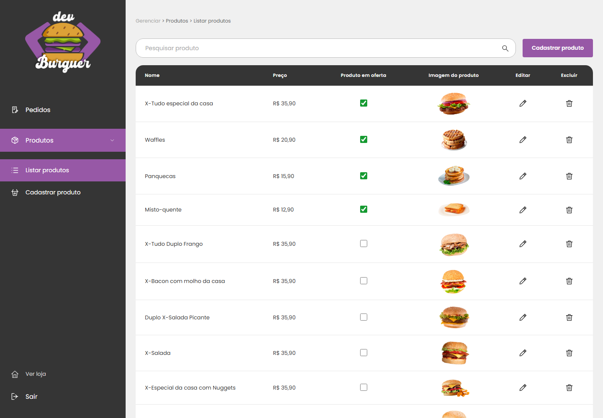
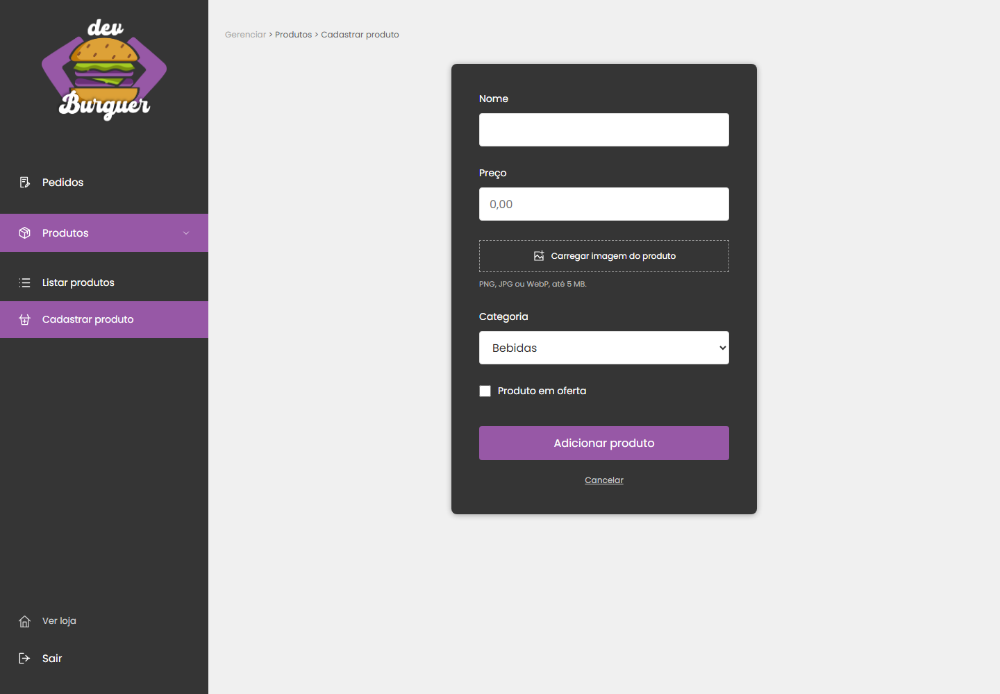

# Catálogo inicial da loja

Esta importação fornece os dados iniciais da loja no PostgreSQL. A home e os cardápios consultam esses registros pela API pública `GET /catalog`; o painel administrativo usa os mesmos produtos e categorias. Os produtos aparecem em **Listar produtos** e podem ser editados, marcados como oferta ou excluídos pelo administrador. As categorias aparecem em **Listar categorias** e no seletor do formulário de produto.

| Categoria | Produtos |
| --- | ---: |
| Hambúrgueres | 11 |
| Bebidas | 9 |
| Sobremesas | 11 |
| Entradas | 9 |
| **Total** | **40** |

Os quatro produtos da home original — X-Tudo especial da casa, Waffles, Panquecas e Misto-quente — entram como ofertas. Os preços preservam o catálogo inicial; R$ 35,90 é armazenado como `35.90`. Descrições, endereços públicos das categorias e imagens acompanham o pacote, inclusive as composições com duas fotos e o combo de nuggets.

## Importar

Na pasta `backend`, com as dependências instaladas e o `.env` apontando para o banco que sua API utiliza:

```sh
node --env-file=.env ./node_modules/sequelize-cli/lib/sequelize db:migrate
npm run seed:catalog
```

Depois, atualize o dashboard ou a home. Se a API não estiver rodando, inicie-a com `npm run dev`. O frontend depende da API para exibir produtos; sem dados no banco, a vitrine exibe um catálogo vazio.

Aplique todas as migrations antes da importação. `20261108120000-product-price-decimal` define preços em reais e `20261108140000-add-live-catalog-metadata` adiciona descrições e endereços públicos estáveis às categorias. Em um banco com importação anterior, esta última usa o histórico de origem para preencher os novos metadados dos itens conhecidos, preservando os demais campos editados.

O comando copia as imagens para `backend/uploads` e cadastra as categorias e produtos em uma transação. Não cria contas, não altera permissões de administrador e não cria pedidos. Ele é executado explicitamente, sem importar dados a cada inicialização do servidor.

## Repetir a importação

Uma tabela de controle identifica os itens por suas chaves de origem. Repetir o comando não duplica itens importados nem sobrescreve alterações feitas no dashboard. Produtos importados que foram excluídos também não são recriados.

Categorias existentes de mesmo nome são reutilizadas. Produtos com o mesmo nome podem ser itens distintos no cardápio original; por isso a identificação usa a chave do item, e não somente o nome. Produtos cadastrados manualmente não são substituídos.

Mantenha a tabela de controle da importação: remover esse histórico elimina a garantia de que uma próxima execução reconheça itens já importados.

## Conferir ou atualizar o pacote

A importação não depende do frontend instalado. O manifesto e suas imagens já estão incluídos nesta pasta.

Para validar o pacote sem conectar ao banco, execute na pasta `backend`:

```sh
node scripts/seed-catalog.cjs --dry-run
```

Para conferir a correspondência com os arquivos atuais da vitrine, na raiz do repositório:

```sh
node backend/catalog/build-catalog.mjs --check
```

O gerador lê os módulos locais do catálogo inicial, preservando chaves, preços, descrições, categorias e imagens. Esses módulos servem para gerar o pacote; a vitrine em execução lê a API. Para atualizar o pacote após uma mudança intencional nesses dados iniciais, execute o mesmo comando sem `--check` e revise o diff. Atualizar o pacote não substitui registros que já foram importados e editados no banco.

## Administrar o catálogo publicado

Depois da importação, use o painel para as alterações cotidianas. Marcar **Produto em oferta** inclui o produto nas ofertas da home; desmarcar o retira dessa seção. O campo `category_id` determina em qual cardápio o produto aparece. O menu **Categorias** permite cadastrar e editar nome, descrição e imagem; os endereços dos cardápios permanecem estáveis após renomear uma categoria.

Alterações salvas são refletidas na vitrine, incluindo abas abertas da mesma loja. Não é necessário executar novamente a importação para publicar essas alterações. O checkout usa os produtos e preços atualizados, mas continua sendo uma simulação, sem enviar pedidos ao PostgreSQL ou realizar cobranças.

## Prévias

Capturas com o catálogo importado em um banco PostgreSQL de teste e servido pela API real:




