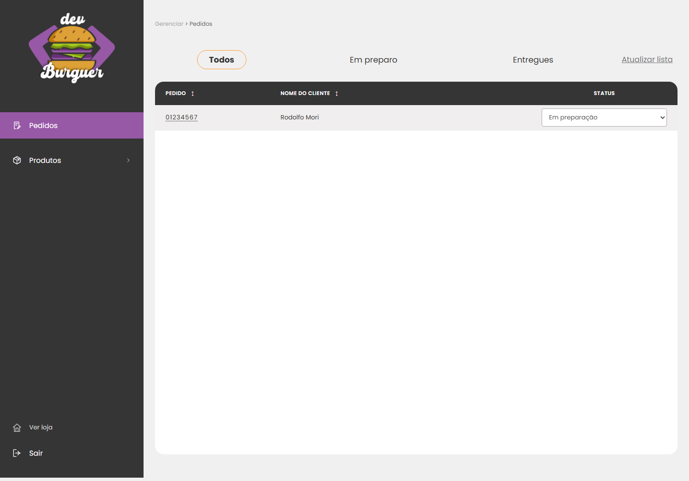
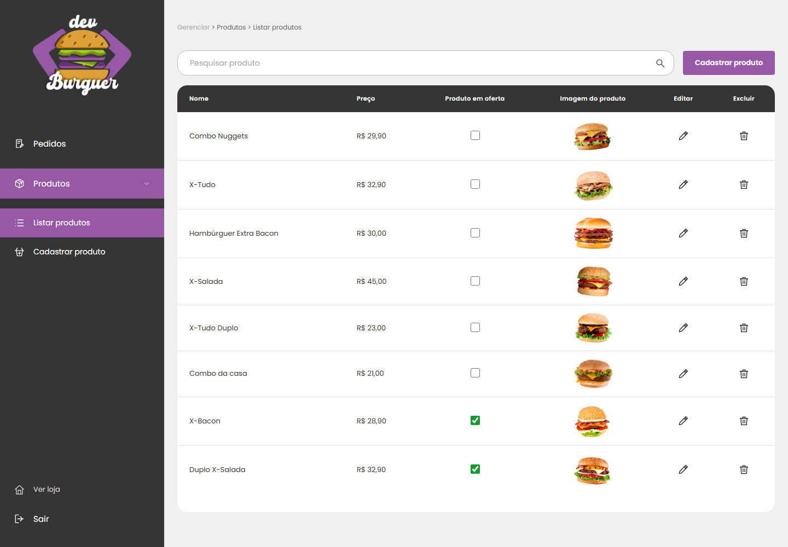
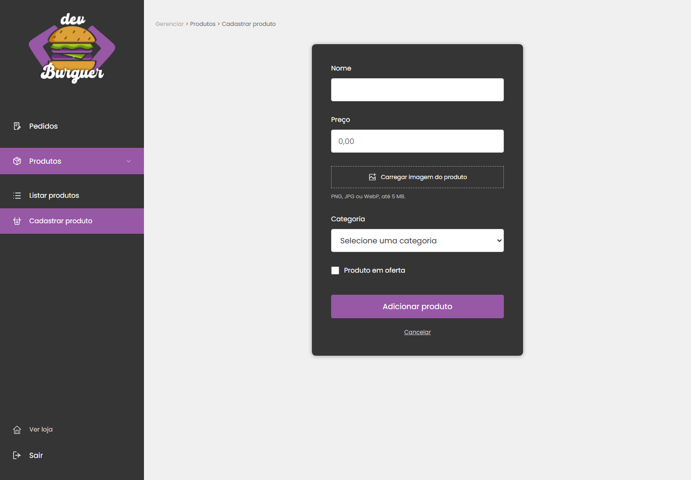
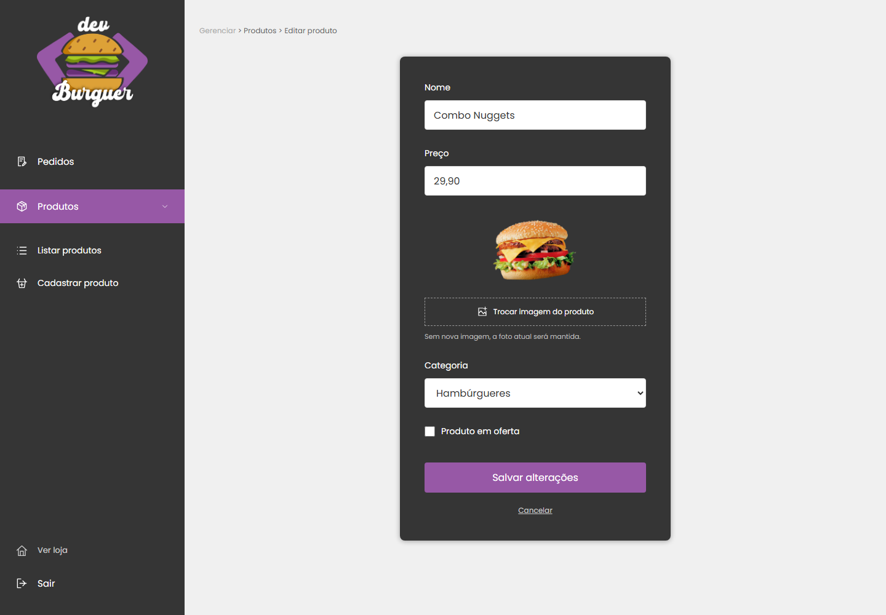
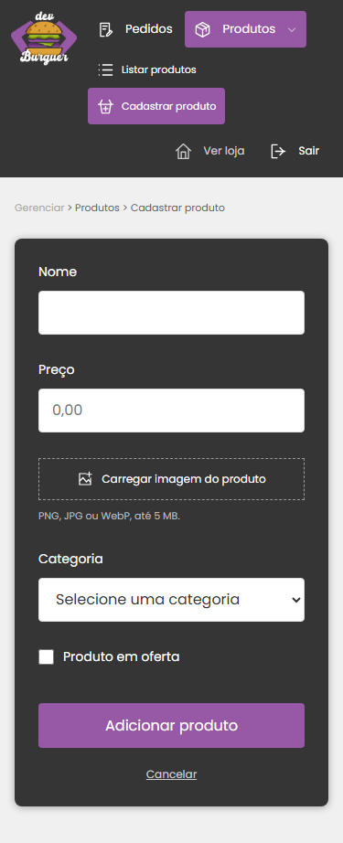

# Painel administrativo

O painel usa a API e os registros do PostgreSQL. O visual segue as referências de pedidos, listagem e formulário com menu lateral escuro, seleção roxa e área de trabalho cinza.

## Login e acesso

- Login com admin: true abre /admin/pedidos.
- Login de cliente abre /.
- Visitante sem sessão é enviado a /login; cliente que digita uma rota /admin retorna à home.
- O painel verifica GET /admin/session antes de carregar o conteúdo. A API consulta o papel atual no banco; alterar sessionStorage ou incluir admin no JWT não concede permissão.
- Todas as alterações de produtos, uploads e status exigem administrador no servidor. Cadastro público continua criando apenas clientes.
- Sair remove a sessão e retorna ao login.

Use uma conta existente cujo campo users.admin seja true, provisionada pelo responsável pelo banco. Este PR não cria credenciais padrão nem promove contas automaticamente.

## Telas e comportamento

| Rota | Funções |
| --- | --- |
| /admin/pedidos | Todos, Em preparo e Entregues; ordenação; detalhes dos itens; mudança de status |
| /admin/produtos | Busca por nome, preço em reais, foto, oferta, edição e exclusão com confirmação |
| /admin/produtos/novo | Nome, preço, imagem, categoria e oferta |
| /admin/produtos/:id/editar | Alteração dos campos e troca opcional da imagem |

Estados aceitos: Pedido realizado, Em preparação, Pronto, A caminho e Entregue. O filtro Em preparo reúne os pedidos ainda não entregues. A mudança só aparece como salva após confirmação da API; erros mantêm o valor anterior.

Uploads de produtos aceitam PNG, JPEG e WebP, até 5 MB. A API verifica extensão, MIME e assinatura do arquivo. No cadastro a imagem é obrigatória; na edição, a foto atual é preservada sem novo arquivo. A exclusão remove o produto do catálogo do banco, preservando os snapshots e imagens de pedidos anteriores.

As categorias do seletor vêm de GET /categories e precisam existir no banco. Para cadastrar as quatro categorias e os 40 produtos da home e dos cardápios, aplique as migrations e execute `npm run seed:catalog` na pasta `backend`. Veja as [instruções da importação](../../backend/catalog/README.md). Os IDs são atribuídos pelo banco e as categorias importadas ficam disponíveis no seletor.

## Atualização do banco

A API passa a tratar products.price em **reais**, com DECIMAL(10,2), para aceitar valores como 29.90. O formulário aceita 29,90 e envia 29.90. A migration preserva os valores numéricos anteriores: 29 passa a 29.00, sem multiplicar ou dividir registros.

Na pasta backend, com backend/.env configurado:

    npm ci
    node --env-file=.env ./node_modules/sequelize-cli/lib/sequelize db:migrate
    npm run dev

A migration 20261108120000-product-price-decimal deve ser aplicada antes de usar o novo CRUD. O rollback recusa a conversão para INTEGER se houver preços fracionários, para não descartar centavos.

Na pasta frontend:

    npm ci
    npm run dev

O proxy /api encaminha as chamadas e as imagens /api/product-file ao backend na porta 3001. frontend/.env.example usa o nome de variável reconhecido pela aplicação: VITE_API_URL. Em produção, configure um proxy equivalente ou a URL de API com CORS autorizado.

## Relação com as telas demonstrativas

A home, os cardápios por categoria e o checkout continuam usando o catálogo demonstrativo local. A importação cria registros equivalentes na API para administração, mas não sincroniza as alterações de volta para a vitrine. A publicação do catálogo da API na vitrine e o envio de pedidos reais pelo checkout serão uma integração separada.

A tela de pedidos mostra somente pedidos já recebidos pela API. Concluir o checkout demonstrativo não cria pedidos no PostgreSQL.

## Validação

Frontend:

    npm test
    npm run build
    npm run test:e2e

Backend:

    npm run test:admin
    npm run test:env

Os testes de navegador usam respostas de API controladas. Os testes de backend exercitam as rotas Express, JWT, permissões, validação, multipart e status, com modelos de banco e gravação de imagens simulados. Nenhum teste altera registros ou arquivos de um banco real. A migration não foi aplicada a um banco de produção.

## Prévias

Os registros das capturas abaixo são dados de teste usados apenas na revisão visual.

