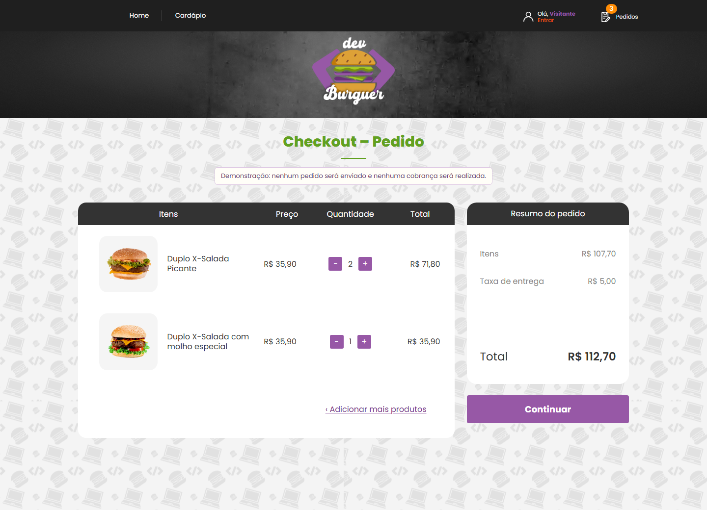
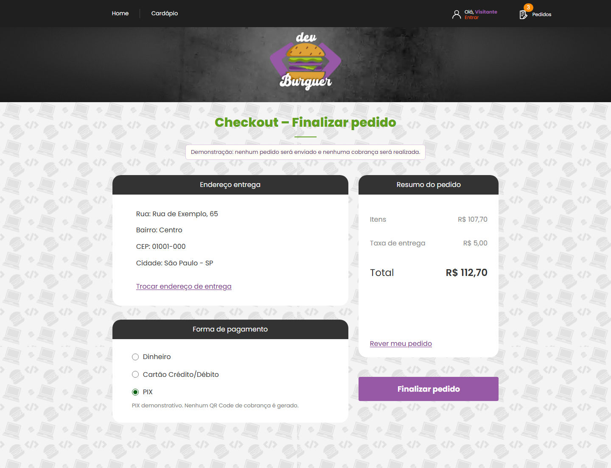
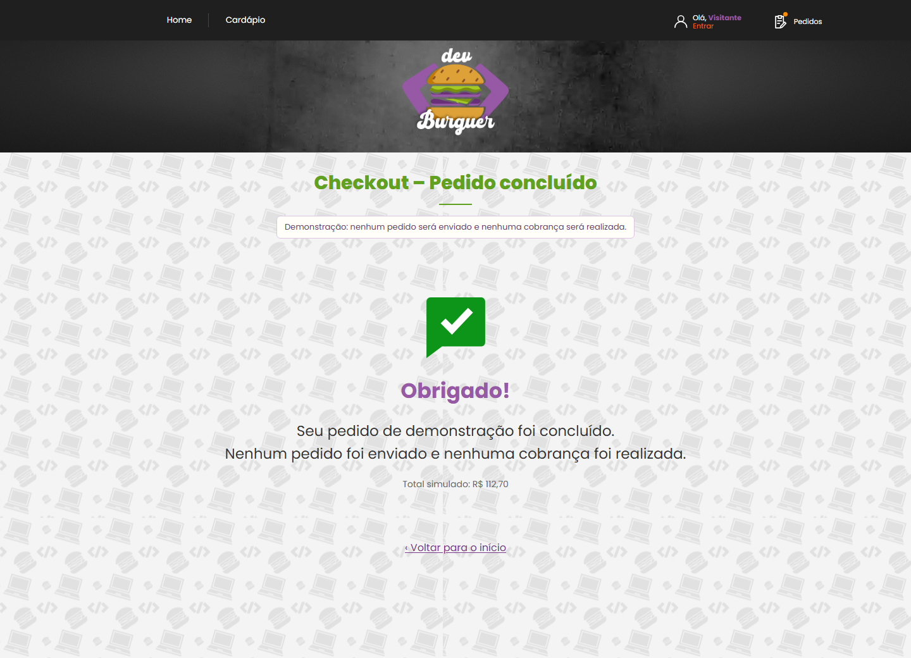

# Checkout demonstrativo

Fluxo funcional de interface, sem envio de pedidos ao backend e sem processamento de pagamentos. As três telas exibem o aviso de demonstração. Os produtos, imagens e preços vêm do catálogo público da API em `GET /catalog`; a simulação se limita à entrega e à conclusão do pedido.

| Tela | Rota | Comportamento |
| --- | --- | --- |
| Carrinho | /carrinho | Produtos escolhidos, preço, quantidade, subtotal e frete simulado |
| Finalizar pedido | /checkout | Endereço de exemplo editável e seleção de Dinheiro, Cartão ou PIX |
| Pedido concluído | /pedido-concluido | Confirmação explícita da demonstração e retorno ao início |

## Experimentar

Mantenha o backend em execução. Para carregar os 40 produtos e as quatro categorias iniciais, configure `backend/.env` e execute na pasta `backend`:

```sh
node --env-file=.env ./node_modules/sequelize-cli/lib/sequelize db:migrate
npm run seed:catalog
npm run dev
```

Em outro terminal, execute `npm run dev` na pasta `frontend`.

1. Na home ou em qualquer categoria, adicione produtos à cesta.
2. Abra **Pedidos** e selecione **Ver carrinho e continuar**.
3. Ajuste as quantidades e clique em **Continuar**.
4. Use **Informar endereço de entrega**, preencha um endereço de exemplo e salve.
5. Escolha a forma de pagamento e clique em **Finalizar pedido**.

A taxa de entrega é fixa em **R$ 5,00**, exclusivamente para a demonstração. Os produtos e preços vêm do catálogo atual da API; os valores das imagens de referência não são usados para sobrescrever preços. O painel controla as ofertas da home pelo checkbox **Produto em oferta** e os cardápios pelo vínculo `category_id`, incluindo as categorias cadastradas em `/admin/categorias`.

## Estados e limites

- Quantidades de 1 a 99; retirar a última unidade remove o item. Carrinho vazio oferece retorno ao cardápio.
- /checkout exige itens na cesta. /pedido-concluido exige uma conclusão demonstrativa anterior.
- Endereço valida campos obrigatórios, UF e CEP de oito dígitos, com ou sem hífen. A edição pode ser cancelada.
- O endereço fica apenas na memória da aplicação e é descartado ao recarregar. Não é enviado nem gravado no armazenamento do navegador.
- Carrinho e favoritos seguem o armazenamento local existente. A conclusão limpa o carrinho, preservando os favoritos.
- O carregamento do catálogo preserva o carrinho até que a API responda. Depois, os preços são atualizados e produtos excluídos deixam a cesta. Sem conexão com o catálogo, as telas exibem erro e permitem tentar novamente.
- Somente o resultado demonstrativo (quantidade, total e opção de pagamento) fica em sessionStorage para manter a confirmação após recarregar a aba. O fluxo também funciona em memória quando o armazenamento está bloqueado.
- PIX não gera QR Code de cobrança. Cartão não solicita números nem dados financeiros.
- O checkout não chama /orders nem serviços de pagamento. A autenticação existente permanece independente deste fluxo.

## Prévias







## Validação

Na pasta frontend, execute npm test, npm run build e npm run test:e2e.

A suíte cobre cálculos em centavos, quantidades, validação e edição de endereço, seleção exclusiva do pagamento, limpeza do carrinho, recarga da confirmação, rotas vazias, armazenamento indisponível, ausência de requisições de compra e layout mobile.
