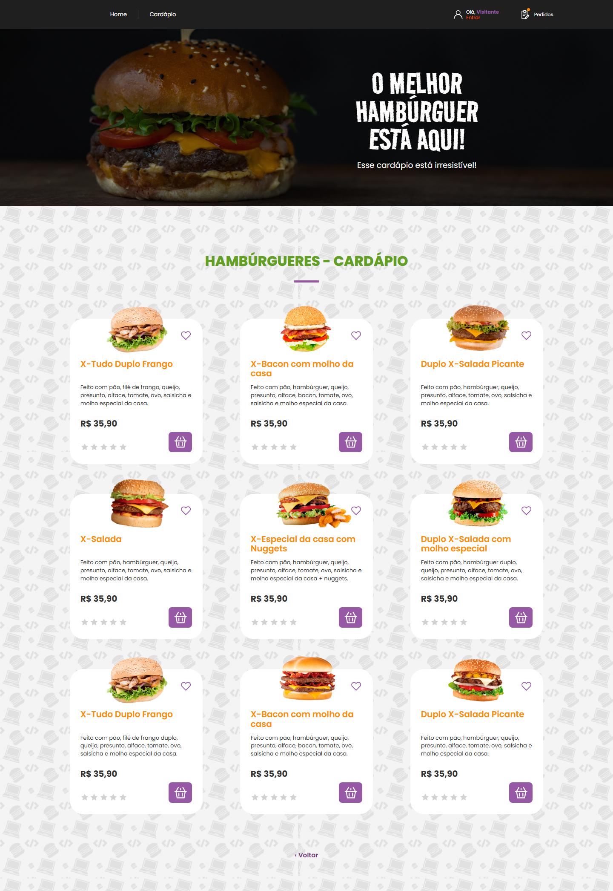

# Cardápio por categoria

As categorias da home abrem suas próprias rotas:

| Categoria | Rota | Conteúdo nesta entrega |
| --- | --- | --- |
| Hambúrgueres | /cardapio/hamburgueres | Banner, nove produtos, favoritos e cesta |
| Bebidas | /cardapio/bebidas | Nove produtos, favoritos e cesta |
| Sobremesas | /cardapio/sobremesas | Nove produtos, favoritos e cesta |
| Entradas | /cardapio/entradas | Nove produtos, favoritos e cesta |

/cardapio redireciona para hambúrgueres. Uma categoria desconhecida retorna à home.

Prévias das novas categorias em 1440px:

- [Bebidas](menu-bebidas-desktop.png)
- [Sobremesas](menu-sobremesas-desktop.png)
- [Entradas](menu-entradas-desktop.png)

## Conteúdo e imagens

- Os arquivos PNG originais enviados ficam em src/features/menu/assets/images e foram preservados sem recortes ou recompressão.
- O banner preenche 100% da largura disponível, inclusive acima de 1440px, mantendo a proporção de 1440 × 415 e a transparência original. Somente o banner acompanha a largura da tela; as fotos dos produtos continuam limitadas ao tamanho nativo.
- Cada categoria tem nove cartões com nomes, descrições e preços das referências fornecidas. Os dados ficam em src/features/menu/data/burgers.js, drinks.js, desserts.js e starters.js. sections.js associa cada categoria ao seu título e aos seus produtos.
- Foram recebidas oito fotos distintas de hambúrgueres, uma de nuggets e o banner. Os dois cartões chamados X-Tudo Duplo Frango usam a foto de frango recebida; o combo reúne as fotos do hambúrguer e dos nuggets em CSS.
- As três novas categorias usam 36 PNGs originais (12 de bebidas, 13 de sobremesas e 11 de entradas). Arquivos repetidos foram deduplicados. Composições de dois alimentos ou bebidas usam imagens separadas, posicionadas em CSS e contidas no espaço reservado, sem ampliar os produtos.
- A foto específica de Coquetéis não foi recebida. Esse cartão mantém nome, preço e ações, com “Imagem em breve” no lugar da foto. Para adicioná-la, basta preencher photos no registro drink-cocktails em drinks.js.
- As estrelas indicam ausência de avaliações, sem notas fictícias.
- A fonte Road Rage é servida localmente; origem: https://github.com/google/fonts/tree/main/ofl/roadrage. A licença SIL OFL acompanha o arquivo.

## Comportamento

A cesta e os favoritos são compartilhados entre rotas. As seleções persistem em localStorage e continuam funcionando em memória quando o armazenamento está indisponível. A cesta mantém preços em centavos, aceita apenas produtos conhecidos e limita cada quantidade a 99.

Login, cadastro e logout continuam usando a autenticação existente. Os botões de cesta fazem apenas a seleção local; esta entrega não envia pedidos ao backend.

## Validação

Na pasta frontend:

- npm test
- npm run build
- npm run test:e2e

Os testes verificam as quatro rotas, navegação, imagens locais, cesta mista, persistência de favoritos, armazenamento bloqueado e larguras de 320 a 3840px. O banner ocupa toda a largura sem distorção; as fotos dos produtos não são ampliadas e a página não tem rolagem horizontal.
